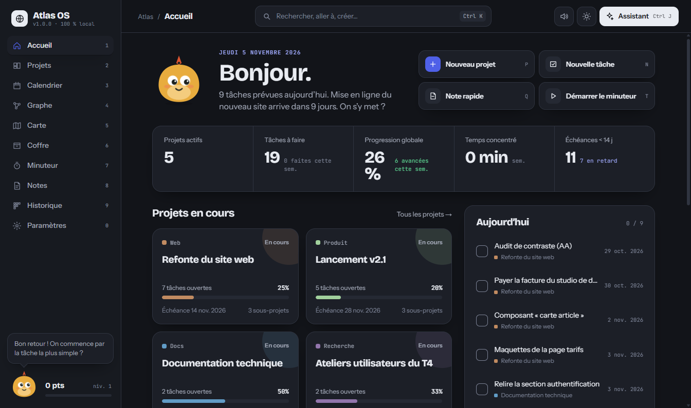
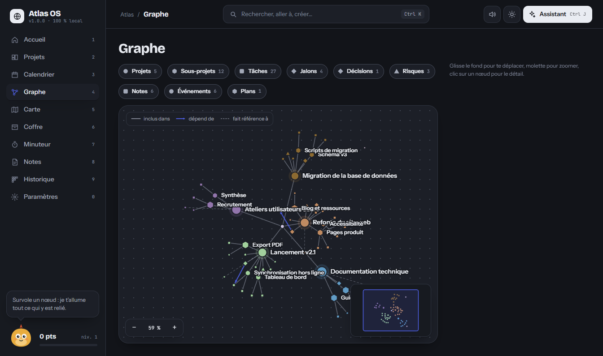
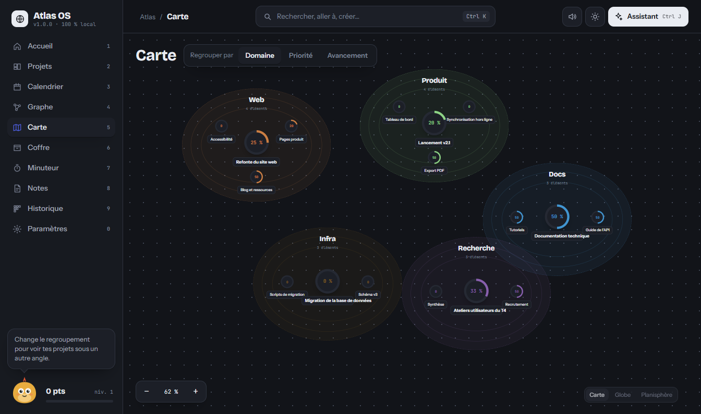
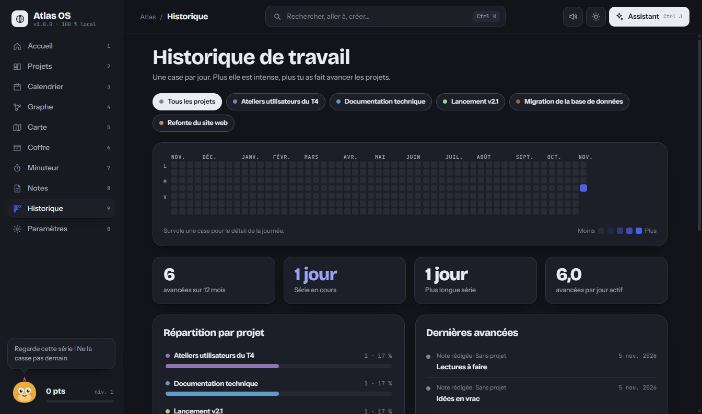
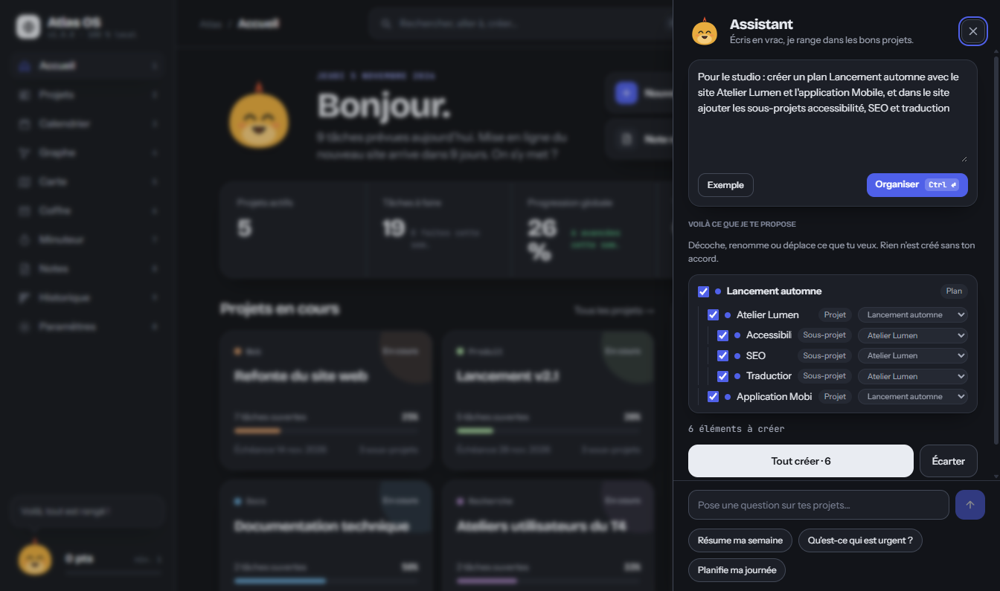
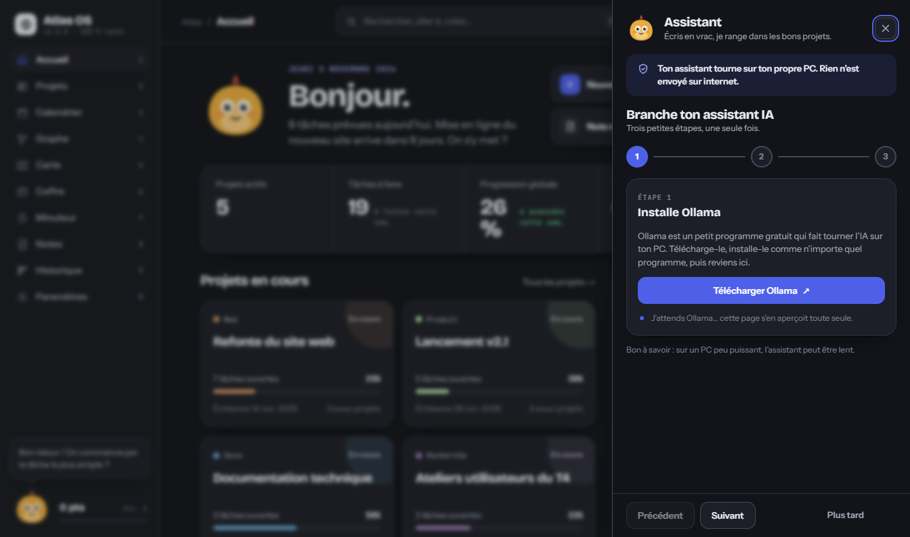

[English](README.md) · **Français**

# Atlas OS

**Ton centre de pilotage personnel pour des projets longs et complexes : projets, tâches, calendrier, notes, documents, carte et graphe de relations, dans une seule application Windows.**

> 🔒 **100 % local. Aucune donnée ne quitte ton PC.** Pas de compte, pas de cloud, pas de télémétrie (seule la vérification des mises à jour, désactivable, interroge GitHub pour connaître la dernière version). Tout est enregistré dans un dossier sur ta machine, et l'application bloque elle-même les connexions de sa fenêtre vers Internet.

<p align="center"></p>

## Fonctionnalités

- **Accueil** : ce qui compte aujourd'hui, en un coup d'œil.
- **Projets** : plans, projets, sous-projets, tâches, échéances et budgets, reliés entre eux.
- **Calendrier** : échéances et événements de tous tes projets.
- **Graphe** : les relations entre tes éléments, à explorer visuellement.
- **Carte** : tes projets et lieux sur une carte du monde.
- **Coffre** : tes documents, rangés dans la base de l'application.
- **Minuteur** : sessions de concentration liées à tes tâches.
- **Notes** et **Historique** : ce que tu écris et ce qui a changé.
- **Assistant IA local (Ctrl+J)** : écris en vrac, il propose une structure à valider (voir plus bas).
- **Palette Ctrl+K** pour aller partout au clavier.
- **Thèmes** (Indigo, Lagon, Violet), **profils sonores** (Doux, Normal, Cristallin) et une mascotte.
- Interface en **français** et en **anglais** (à changer dans **Paramètres → Langue et espace de travail**).

| Graphe                                                           | Carte                                                          | Historique de travail                                                    |
| ---------------------------------------------------------------- | -------------------------------------------------------------- | ------------------------------------------------------------------------ |
|  |  |  |

<p align="center"></p>

_Captures réalisées sur les données d'exemple publiques (un studio web inventé)._

## Installation sur Windows

1. Va dans l'onglet [**Releases**](https://github.com/TheLion007/atlas-os/releases) et télécharge `Atlas-OS-Setup-<version>.exe`.
2. Lance le fichier et suis l'installateur (installation pour ton utilisateur, pas besoin d'être administrateur).
3. Au premier lancement, Windows peut afficher **« Windows a protégé votre PC »**.

### L'alerte SmartScreen, c'est normal

L'installateur n'est **pas encore signé numériquement** (un certificat de signature est payant). Windows se méfie donc de tout programme peu répandu. Ce n'est pas un signe de problème : le code complet est ici, lisible et vérifiable.

Pour continuer :

1. Clique sur **Informations complémentaires**.
2. Clique sur **Exécuter quand même**.

Le pare-feu Windows peut aussi demander une fois s'il doit autoriser l'application : le serveur interne n'écoute que sur ton PC (`127.0.0.1`), tu peux refuser sans conséquence.

### Où sont tes données ?

Dans `%APPDATA%\Atlas OS`. Désinstaller ou mettre à jour ne les supprime **jamais**. Pour faire une sauvegarde, copie ce dossier (application fermée).

### Mises à jour automatiques

Au lancement, puis toutes les quelques heures, Atlas OS regarde sur GitHub s'il existe une version plus récente. Si oui, un message **« Nouvelle version disponible »** apparaît : tu cliques sur **Télécharger**, puis sur **Redémarrer et installer**. Rien ne se télécharge ni ne s'installe sans ton clic, et tes données (`%APPDATA%\Atlas OS`) ne sont jamais touchées.

**Cette vérification contacte GitHub uniquement pour connaître le numéro de la dernière version : aucune donnée n'est envoyée** (ni projets, ni notes, ni identifiant). C'est la seule connexion qu'Atlas OS fait vers Internet.

Tu peux la **désactiver** dans **Paramètres → Langue et espace de travail** (interrupteur « Vérifier les mises à jour automatiquement »). Le bouton **Vérifier maintenant** te donne la version installée et l'état de la vérification.

Les mises à jour commencent avec la version 1.0.1 : si tu as installé la 1.0.0, installe la 1.0.1 à la main une fois, puis les suivantes arriveront toutes seules.

## Assistant IA (optionnel, 100 % local)

L'assistant (**Ctrl+J**) comprend un texte écrit en vrac et propose de créer plans, projets, sous-projets, tâches, notes et échéances. Tu vois la proposition, tu décoches, renommes ou déplaces ce que tu veux, puis **Tout créer**. **Annuler la dernière création** défait tout d'un clic.

Il fonctionne avec [**Ollama**](https://ollama.com), un programme qui fait tourner des modèles d'IA sur ton propre PC. Rien n'est envoyé sur Internet. Sans Ollama, Atlas OS reste entièrement utilisable.

### Tutoriel Ollama en 3 étapes

<p align="center"></p>

1. **Installer Ollama** : télécharge-le sur [ollama.com/download](https://ollama.com/download) et installe-le. Il tourne ensuite en arrière-plan.
2. **Télécharger un modèle** : dans un terminal, lance par exemple

   ```bash
   ollama pull qwen2.5:7b
   ```

   `llama3.2:3b` est plus léger si ton PC est modeste ; `llama3.1:8b` et `mistral` fonctionnent aussi.

3. **Choisir le modèle dans Atlas OS** : ouvre l'assistant (Ctrl+J) ou **Paramètres**, Atlas OS détecte Ollama et te guide pas à pas.

Le premier chargement d'un modèle peut prendre une minute ; ensuite il reste en mémoire et les réponses arrivent en quelques secondes.

## Pour les développeurs

Prérequis : Node.js 22+.

```bash
npm install
npm run dev            # http://127.0.0.1:3000
npm run check          # lint + types + tests + format
npm run dist:win       # construit l'installateur dans release/
```

La documentation technique est dans [`docs/`](docs/) : [architecture](docs/ARCHITECTURE.md), [base de données](docs/DATABASE.md), [design system](docs/DESIGN-SYSTEM.md), [application de bureau](docs/DESKTOP.fr.md), [développement](docs/DEVELOPMENT.md).

## Contribuer

Les contributions sont les bienvenues. Les détails sont dans [CONTRIBUTING.fr.md](CONTRIBUTING.fr.md).

1. Fais un _fork_ du dépôt, crée une branche (`git checkout -b ma-modification`).
2. Avant de proposer ta modification, lance `npm run check` : types, lint, tests et format doivent passer.
3. Ouvre une _pull request_ en expliquant ce qui change et pourquoi.

Une règle de design à respecter : l'interface suit la maquette de référence. Pas de nouveau bouton, panneau ou style sans accord préalable (ouvre une discussion d'abord).

## Signaler un problème

Ouvre une [**issue**](https://github.com/TheLion007/atlas-os/issues) en indiquant : ta version d'Atlas OS (visible dans Paramètres), ce que tu as fait, ce que tu attendais et ce qui s'est passé. Le journal de l'application est dans `%APPDATA%\Atlas OS\logs\atlas-os.log` (il ne contient aucun contenu personnel). **Ne joins jamais ta base de données** ni de documents privés.

## Licence

[MIT](LICENSE) © 2026 TheLion007. Tu peux utiliser, modifier et redistribuer Atlas OS librement.
