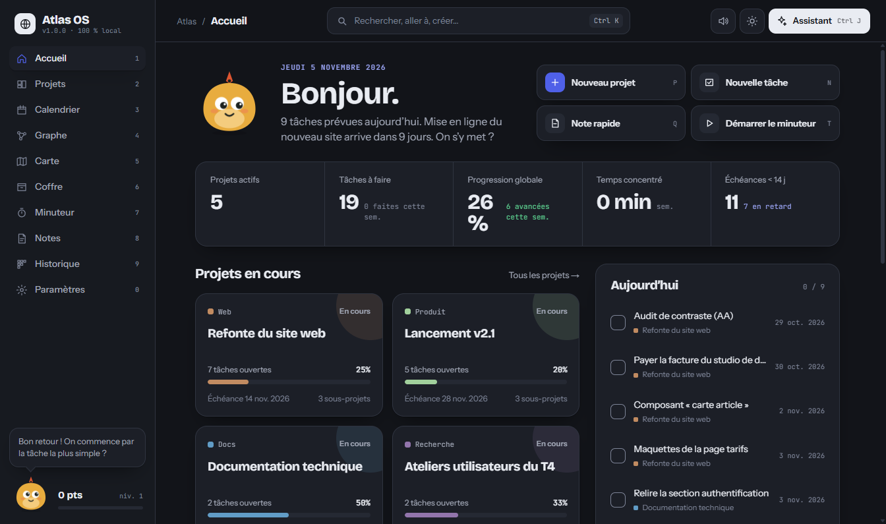
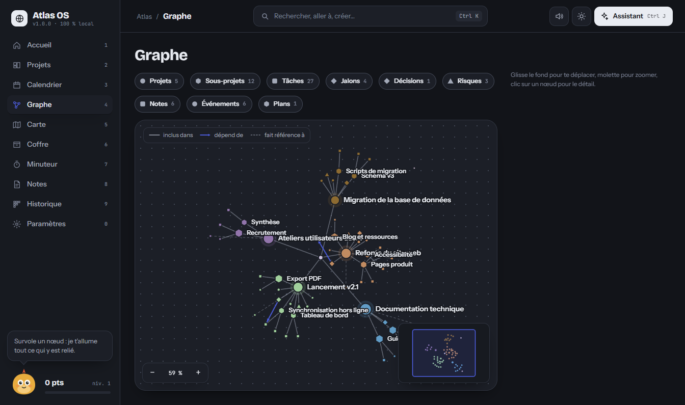
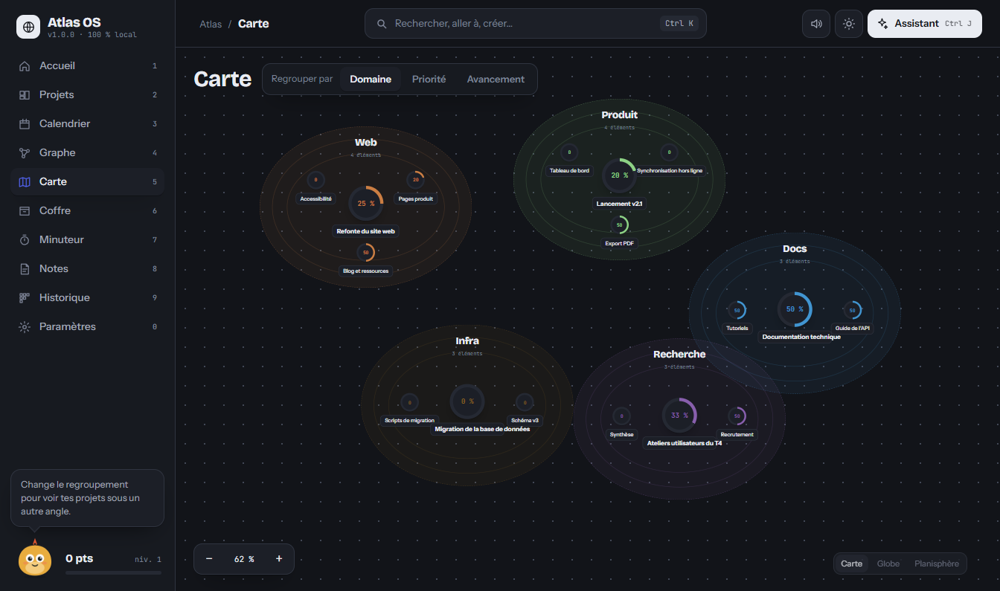
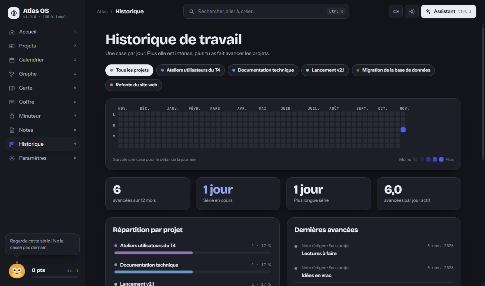
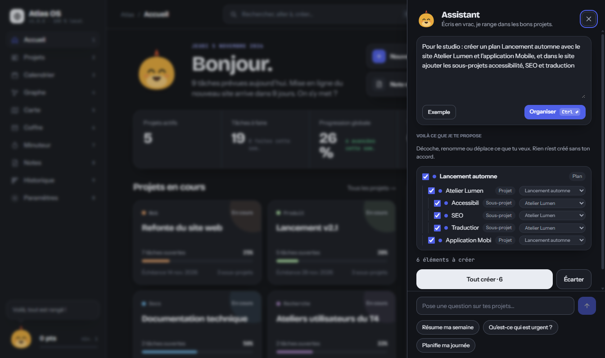
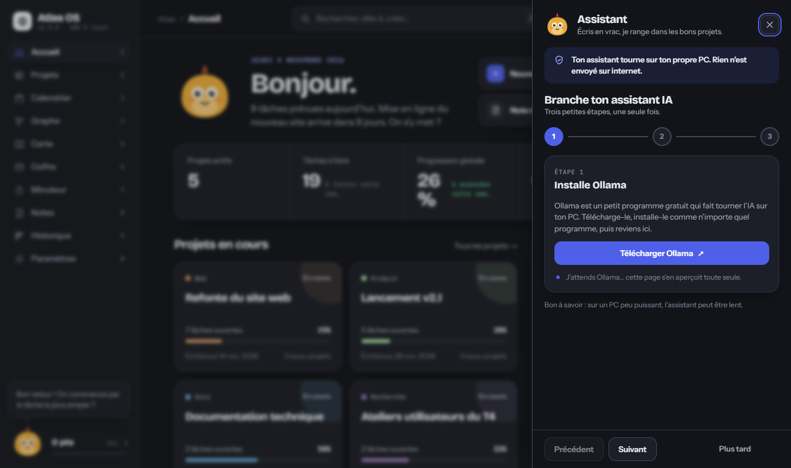

**English** · [Français](README.fr.md)

# Atlas OS

**Your personal command center for long, complex projects: projects, tasks, calendar, notes, documents, a map and a relationship graph, all in one Windows app.**

> 🔒 **100% local. No data ever leaves your PC.** No account, no cloud, no telemetry (the only exception is the update check, which you can switch off: it asks GitHub for the latest version number and nothing else). Everything is stored in a folder on your machine, and the app itself blocks its window from reaching the internet.

<p align="center"></p>

> 🌐 **Language:** the app's interface is available in **English and French** (switch it in **Settings → Language and workspace**). The screenshots in this README were taken in French; they show the same screens.

## Features

- **Home**: what matters today, at a glance.
- **Projects**: plans, projects, sub-projects, tasks, deadlines and budgets, all linked together.
- **Calendar**: deadlines and events from all your projects.
- **Graph**: the relationships between your items, to explore visually.
- **Map**: your projects and places on a world map.
- **Vault**: your documents, stored inside the app's database.
- **Timer**: focus sessions tied to your tasks.
- **Notes** and **History**: what you write and what has changed.
- **Local AI assistant (Ctrl+J)**: write things down loosely and it proposes a structure for you to approve (see below).
- **My data (Settings)**: export and import backups, choose where your data lives, automatic daily backup (see below).
- **Command palette (Ctrl+K)** to go anywhere from the keyboard.
- **Themes** (Indigo, Lagoon, Violet), **sound profiles** (Soft, Normal, Crystal) and a mascot.

| Graph                                                           | Map                                                          | Work history                                                          |
| --------------------------------------------------------------- | ------------------------------------------------------------ | --------------------------------------------------------------------- |
|  |  |  |

<p align="center"></p>

_Screenshots taken on the public example data (an invented web studio)._

## Installing on Windows

1. Go to the [**Releases**](https://github.com/TheLion007/atlas-os/releases) tab and download `Atlas-OS-Setup-<version>.exe`.
2. Run the file and follow the installer (it installs for your user, no administrator rights needed).
3. On first launch, Windows may show **"Windows protected your PC"**.

### The SmartScreen warning is expected

The installer is **not code-signed yet** (a signing certificate costs money), so Windows is wary of any program that is not widely used. This is not a sign of a problem: the full source code is right here, readable and verifiable.

To continue:

1. Click **More info**.
2. Click **Run anyway**.

The Windows firewall may also ask once whether to allow the app: its internal server only listens on your own PC (`127.0.0.1`), so you can safely decline.

### Where is my data?

By default in `%APPDATA%\Atlas OS`, but you can choose another folder (see below). Uninstalling or updating **never** deletes it.

## My data: backups, data folder, two PCs

Everything is in **Settings → My data**. It all stays **100% local**: no account, no server, nothing leaves your PC.

- **Export and import.** _Export my data_ creates one `.atlasbackup` file (projects, tasks, notes, work history, Vault documents with their files, timer, settings, mascot, preferences). You choose where to save it. _Import_ checks the file first, shows what is inside, then offers two modes:
  - **Merge**: adds what is missing. If an item exists on both sides, the most recent one is kept. Nothing is deleted.
  - **Replace**: your current data is replaced by the backup (a clear confirmation is asked first).

  Before any import, Atlas OS **automatically makes a safety copy** of your current data (in `sauvegardes\securite` inside your data folder). If an import fails, the previous state is put back.

- **Data folder.** _Data location → Change…_ lets you store everything in a folder of your choice, for example a **OneDrive, Google Drive, Dropbox or Syncthing** folder, to keep two PCs up to date. Atlas OS asks whether to move your existing data there or to use the data already in that folder (for your second PC). While Atlas OS is open it leaves a small lock file in the folder: if you open the same folder on another PC, you get **"Atlas OS is already open on [device]"** and can choose read-only, force opening, or quit.

- **Daily automatic backup.** Turn it on, choose a folder, and Atlas OS writes one `.atlasbackup` a day and keeps the **last 7**.

### Known limits

- Syncing through a cloud service has **not been tested with a real service** (OneDrive, Google Drive, Dropbox, Syncthing): it was tested with ordinary folders.
- The **activity log** and the **preferences** are not merged in _Merge_ mode (preferences come back with _Replace_).
- After a sudden stop (crash, power cut), the lock stays active for **up to 2 minutes**; after that another PC can open the folder normally.
- Two PCs must not work at the same time on the same folder: use the read-only mode to look, not to edit.

### Automatic updates

At launch, then every few hours, Atlas OS checks GitHub for a newer version. If there is one, a **"New version available"** notice appears: you click **Download**, then **Restart and install**. Nothing is downloaded or installed without your click, and your data (`%APPDATA%\Atlas OS`) is never touched.

**This check contacts GitHub only to learn the number of the latest version: no data is sent** (no projects, no notes, no identifier). It is the only connection Atlas OS makes to the internet.

You can **turn it off** in **Settings → Language and workspace** (the "Check for updates automatically" switch). The **Check now** button shows the installed version and the state of the check.

Updates start with version 1.0.1: if you installed 1.0.0, install 1.0.1 by hand once, and later versions will arrive by themselves.

## AI assistant (optional, 100% local)

The assistant (**Ctrl+J**) understands loosely written text and proposes plans, projects, sub-projects, tasks, notes and deadlines to create. You see the proposal, untick, rename or move whatever you like, then click **Create all**. **Undo the last creation** takes it all back in one click.

It works with [**Ollama**](https://ollama.com), a program that runs AI models on your own PC. Nothing is sent over the internet. Without Ollama, Atlas OS stays fully usable.

### Ollama tutorial in 3 steps

<p align="center"></p>

1. **Install Ollama**: download it from [ollama.com/download](https://ollama.com/download) and install it. It then runs in the background.
2. **Download a model**: in a terminal, run for example

   ```bash
   ollama pull qwen2.5:7b
   ```

   `llama3.2:3b` is lighter if your PC is modest; `llama3.1:8b` and `mistral` also work.

3. **Pick the model in Atlas OS**: open the assistant (Ctrl+J) or **Settings**; Atlas OS detects Ollama and guides you step by step.

The first load of a model can take a minute; after that it stays in memory and answers arrive within seconds.

## For developers

Requirements: Node.js 22+.

```bash
npm install
npm run dev            # http://127.0.0.1:3000
npm run check          # lint + types + tests + format
npm run dist:win       # builds the installer into release/
```

Technical documentation lives in [`docs/`](docs/): [architecture](docs/ARCHITECTURE.md), [database](docs/DATABASE.md), [design system](docs/DESIGN-SYSTEM.md), [desktop app](docs/DESKTOP.md), [development](docs/DEVELOPMENT.md).

## Contributing

Contributions are welcome. See [CONTRIBUTING.md](CONTRIBUTING.md) for the details.

1. Fork the repository and create a branch (`git checkout -b my-change`).
2. Before proposing your change, run `npm run check`: types, lint, tests and formatting must pass.
3. Open a _pull request_ explaining what changes and why.

One design rule to respect: the interface follows the reference design. No new button, panel or style without prior agreement (open a discussion first).

## Reporting a problem

Open an [**issue**](https://github.com/TheLion007/atlas-os/issues) and tell us: your Atlas OS version (shown in Settings), what you did, what you expected and what happened. The app's log is at `%APPDATA%\Atlas OS\logs\atlas-os.log` (it contains no personal content). **Never attach your database** or private documents.

## License

[MIT](LICENSE) © 2026 TheLion007. You are free to use, modify and redistribute Atlas OS.
